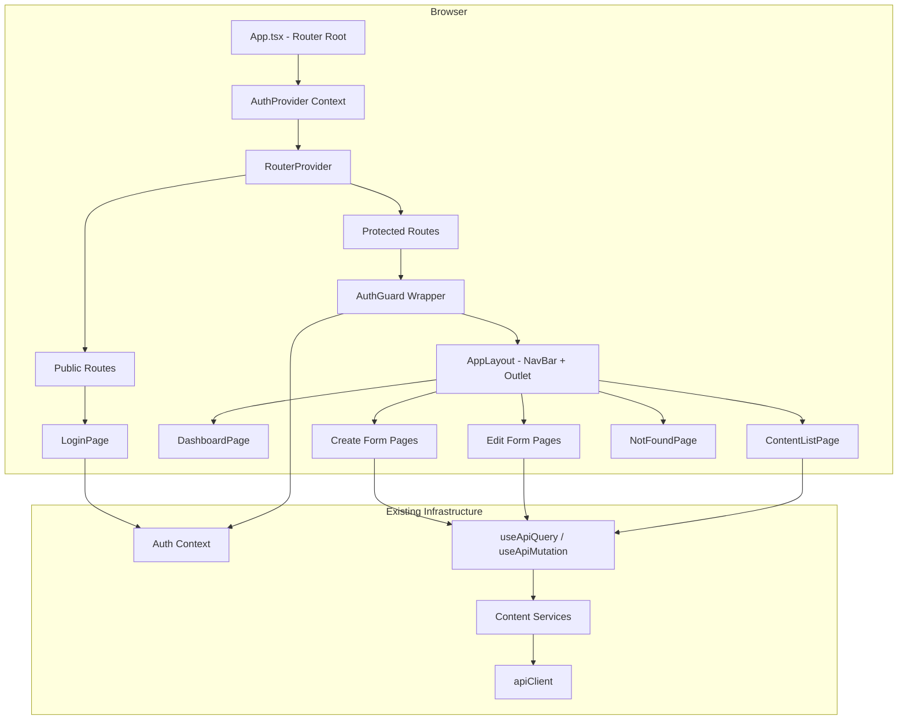

# Design Document: Ambassador UI

## Overview

The Ambassador UI is a React single-page application providing content management capabilities for the SRH Ambassador Platform. It enables authenticated users (students, ambassadors, professors) to log in, view a personalized dashboard, create and edit content entities (activity clubs, buildings, events, news articles), and navigate the platform via a consistent navigation structure.

The application leverages the existing API client layer, content services, authentication context, and custom hooks (`useApiQuery`, `useApiMutation`). The primary new work involves building the UI component tree, routing infrastructure, form components, and page-level compositions.

### Key Design Decisions

1. **React Router v7** for client-side routing — the de facto standard for React SPAs, supporting nested routes, route guards, and programmatic navigation.
2. **Component-driven architecture** — pages compose shared layout and form components, reducing duplication.
3. **Validation logic extracted into pure functions** — enables property-based testing independent of React rendering.
4. **Role-based conditional rendering** — driven by the existing `useAuth()` hook's `role` value rather than duplicating permission logic.

## Architecture



### Routing Structure

| Path | Component | Access |
|------|-----------|--------|
| `/login` | LoginPage | Public (redirects if authenticated) |
| `/` | DashboardPage | Protected |
| `/activity-clubs` | ContentListPage | Protected |
| `/activity-clubs/new` | CreateClubPage | Protected |
| `/activity-clubs/:id/edit` | EditClubPage | Protected |
| `/buildings` | ContentListPage | Protected |
| `/buildings/new` | CreateBuildingPage | Protected |
| `/buildings/:id/edit` | EditBuildingPage | Protected |
| `/events` | ContentListPage | Protected |
| `/events/new` | CreateEventPage | Protected |
| `/events/:id/edit` | EditEventPage | Protected |
| `/news-articles` | ContentListPage | Protected |
| `/news-articles/new` | CreateNewsArticlePage | Protected |
| `/news-articles/:id/edit` | EditNewsArticlePage | Protected |
| `*` | NotFoundPage | Public |

## Components and Interfaces

### Core Layout Components

```typescript
// src/components/layout/AppLayout.tsx
interface AppLayoutProps {
  children?: React.ReactNode;
}
// Renders NavBar at top + <Outlet /> for nested route content

// src/components/layout/NavBar.tsx
interface NavBarProps {
  username: string;
  onLogout: () => void;
}
// Links: Dashboard, Activity Clubs, Buildings, Events, News Articles
// Right side: truncated username + logout button
```

### Auth Guard

```typescript
// src/components/auth/AuthGuard.tsx
interface AuthGuardProps {
  children: React.ReactNode;
}
// Checks useAuth().isAuthenticated
// If false: stores current path, redirects to /login
// If isLoading: renders loading spinner
// If true: renders children
```

### Form Components

```typescript
// src/components/forms/FormField.tsx
interface FormFieldProps {
  label: string;
  name: string;
  type: 'text' | 'textarea' | 'richtext' | 'datetime' | 'select';
  required?: boolean;
  maxLength?: number;
  error?: string;
  value: string;
  onChange: (value: string) => void;
  options?: { value: string; label: string }[];
  placeholder?: string;
}

// src/components/forms/FormActions.tsx
interface FormActionsProps {
  isLoading: boolean;
  submitLabel?: string;
  onCancel?: () => void;
}
// Renders submit button (disabled when loading) + optional cancel button
```

### Page Components

```typescript
// src/pages/LoginPage.tsx
// Uses useAuth().login, handles form state locally
// Redirects to dashboard (or stored path) on success

// src/pages/DashboardPage.tsx
// Uses useAuth() for role and profile data
// Renders welcome message + role-appropriate quick-action cards

// src/pages/content/ContentListPage.tsx
interface ContentListPageProps {
  contentType: 'activity-clubs' | 'buildings' | 'events' | 'news-articles';
  displayName: string;
  nameField: string; // field to display as "name" in listing
}
// Uses useApiQuery with pagination, renders table/cards

// src/pages/content/CreateClubPage.tsx
// src/pages/content/CreateBuildingPage.tsx
// src/pages/content/CreateEventPage.tsx
// src/pages/content/CreateNewsArticlePage.tsx
// Each uses useApiMutation, local form state, and validation functions

// src/pages/content/EditPage.tsx
// Generic edit page that fetches entity by ID, pre-populates form
// Re-uses same validation as create forms
```

### Utility Functions (Pure, Testable)

```typescript
// src/utils/validation.ts
export interface ValidationResult {
  valid: boolean;
  errors: Record<string, string>;
}

export function validateClubForm(data: { name: string }): ValidationResult;
export function validateBuildingForm(data: { name: string; code: string; address: string }): ValidationResult;
export function validateEventForm(data: { title: string; starts_at: string; ends_at: string; event_status: string }): ValidationResult;
export function validateNewsArticleForm(data: { title: string; body: string }): ValidationResult;

// src/utils/format.ts
export function truncateUsername(username: string, maxLength?: number): string;

// src/utils/permissions.ts
export type ContentType = 'activity-clubs' | 'buildings' | 'events' | 'news-articles';
export function getPermittedContentTypes(role: UserRole): ContentType[];
```

## Data Models

### Form State Types

```typescript
// src/types/forms.ts
export interface ClubFormData {
  name: string;
  description: string; // Rich text stored as string for the editor
}

export interface BuildingFormData {
  name: string;
  code: string;
  address: string;
  campus: string; // documentId of selected campus, or empty
}

export interface EventFormData {
  title: string;
  description: string;
  starts_at: string; // ISO datetime string
  ends_at: string;   // ISO datetime string
  event_status: string;
  location: string;  // documentId of selected location, or empty
}

export interface NewsArticleFormData {
  title: string;
  summary: string;
  body: string; // Rich text stored as string for the editor
}
```

### Pagination State

```typescript
export interface PaginationState {
  page: number;
  pageSize: number;
  pageCount: number;
  total: number;
}
```

### Redirect Store

```typescript
// src/utils/redirect-store.ts
const REDIRECT_KEY = 'ambassador_redirect_path';

export function storeRedirectPath(path: string): void;
export function getRedirectPath(): string | null;
export function clearRedirectPath(): void;
```

## Correctness Properties

*A property is a characteristic or behavior that should hold true across all valid executions of a system — essentially, a formal statement about what the system should do. Properties serve as the bridge between human-readable specifications and machine-verifiable correctness guarantees.*

### Property 1: Username Truncation

*For any* string, if the string length exceeds 20 characters, `truncateUsername` SHALL return a string of exactly 23 characters (20 + "..."); otherwise it SHALL return the original string unchanged.

**Validates: Requirements 3.2**

### Property 2: Role-Based Dashboard Card Visibility

*For any* user role value (student, ambassador, professor, or null), the set of content types returned by `getPermittedContentTypes(role)` SHALL equal `['activity-clubs', 'buildings', 'events', 'news-articles']` when the role is 'student' or 'ambassador', and SHALL equal `['buildings', 'news-articles']` when the role is 'professor' or null.

**Validates: Requirements 4.2, 4.3**

### Property 3: Required Field Validation Rejects Empty/Whitespace Input

*For any* content type form and *for any* required field in that form, if the field value is empty or composed entirely of whitespace characters, the corresponding validation function SHALL return `valid: false` with an error message for that field.

**Validates: Requirements 6.3, 7.3, 8.4, 9.3**

### Property 4: Event Date Validation

*For any* pair of datetime strings where `ends_at` is less than or equal to `starts_at`, `validateEventForm` SHALL return `valid: false` with an error containing "End time must be after start time".

**Validates: Requirements 8.3**

### Property 5: Content Listing Displays Name and Date

*For any* non-empty array of content entities (each having a name-like field and `createdAt`), the rendered content listing SHALL produce output containing both the entity's display name and a formatted representation of its creation date for every entity in the array.

**Validates: Requirements 5.2**

### Property 6: Edit Validation Matches Create Validation

*For any* content type and *for any* input data, applying the validation function during editing SHALL produce the same validation result as applying it during creation — since both use the same `validate*Form` function.

**Validates: Requirements 10.4**

### Property 7: Protected Route Redirect for Unauthenticated Users

*For any* route path that is not `/login`, when the authentication state is unauthenticated, the AuthGuard SHALL prevent rendering the protected content and redirect to `/login`, storing the originally requested path.

**Validates: Requirements 11.1**

## Error Handling

### API Error Display Strategy

| Error Type | User-Facing Behavior |
|---|---|
| Network error (status 0) | "Service is unreachable. Please check your connection." |
| 401 Unauthorized (non-auth endpoint) | Auto-logout, redirect to login |
| 400 Validation error | Display field-level errors from `details[].path` and `details[].message` |
| 400 Uniqueness violation | Display contextual message (e.g., "A club with that name already exists") |
| 404 Not Found (edit page) | "This item was not found" + link back to listing |
| 500+ Server error | "Something went wrong. Please try again." + retry button where applicable |
| Timeout (30s) | "Request timed out. Please try again." |

### Form Error Preservation

When a backend error occurs during form submission:
1. The error message is displayed at the top of the form or inline with the relevant field.
2. All user-entered data is preserved in the form state.
3. The submit button is re-enabled so the user can retry.

### Loading States

- **Page-level loading**: Full-page spinner during session restoration and initial content fetches.
- **Form-level loading**: Submit button shows loading indicator and is disabled; form fields remain visible but non-interactive during submission.
- **Inline loading**: Content listing shows skeleton/placeholder rows while fetching.

## Testing Strategy

### Unit Tests (Example-Based)

Unit tests verify specific UI behaviors, rendering, and integration flows:

- **LoginPage**: Renders fields, handles success redirect, shows error on failure, loading state.
- **DashboardPage**: Renders welcome message, shows correct cards per role, shows focus area for ambassador.
- **ContentListPage**: Renders entities, handles empty state, shows pagination controls, error + retry.
- **Create/Edit Pages**: Renders forms, pre-populates on edit, handles backend errors, navigates on success.
- **NavBar**: Renders links, shows truncated username, logout works.
- **AuthGuard**: Redirects unauthenticated, renders children when authenticated.
- **NotFoundPage**: Renders 404 message with dashboard link.

### Property-Based Tests (fast-check)

Property tests validate universal correctness properties across generated inputs. Using the `fast-check` library already in devDependencies.

**Configuration:**
- Minimum 100 iterations per property test
- Each test tagged with: `Feature: ambassador-ui, Property {N}: {description}`

**Properties to implement:**
1. `truncateUsername` — round-trip correctness for all string lengths
2. `getPermittedContentTypes` — exhaustive role mapping
3. `validateClubForm`, `validateBuildingForm`, `validateEventForm`, `validateNewsArticleForm` — required field rejection for whitespace inputs
4. `validateEventForm` — date ordering invariant
5. Content listing render function — name/date presence invariant
6. Validation function identity between create and edit flows
7. AuthGuard redirect behavior for all non-login paths

### Integration Tests (MSW)

Using `msw` (already in devDependencies) to mock Strapi API responses:

- Login flow end-to-end (credentials → token storage → profile fetch → dashboard)
- Session restoration (token present → /api/users/me → authenticated state)
- Content CRUD flows (list → create → navigate → verify in list)
- 401 interceptor triggers logout across different endpoints
- Pagination (page navigation, page size)

### Test Tools

| Tool | Purpose |
|------|---------|
| `vitest` | Test runner |
| `@testing-library/react` | Component rendering and interaction |
| `msw` | API mocking |
| `fast-check` | Property-based test generation |
| `jsdom` | Browser environment simulation |
