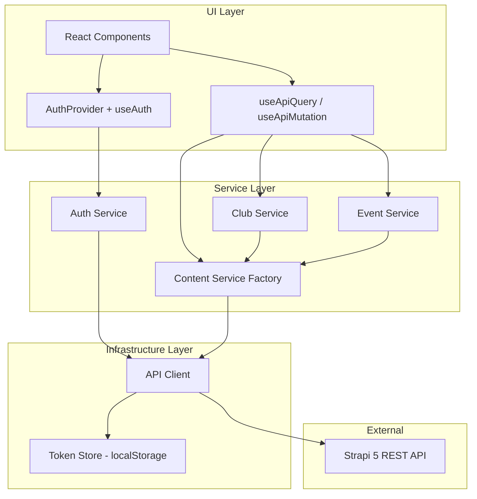
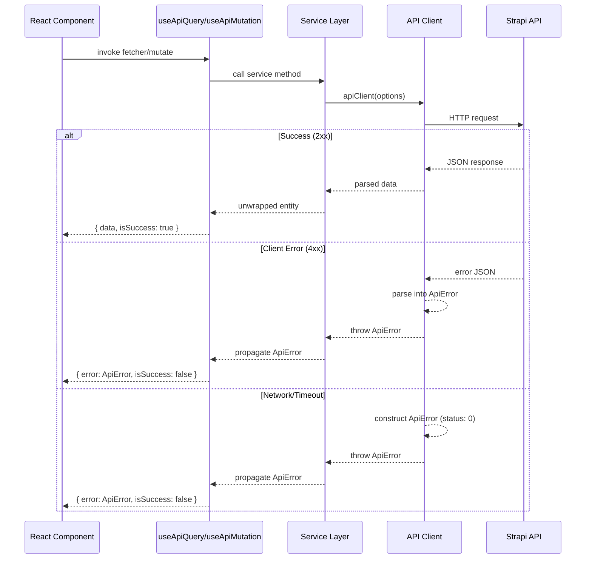

# Design Document: Frontend-Backend Integration

## Overview

This design establishes the integration layer between the React 19 frontend (Vite + TypeScript) and the Strapi 5 REST API backend for the University Ambassadors CMS. The integration layer provides:

- A centralized, typed HTTP client configured for the Strapi REST API
- Authentication services using Strapi's users-permissions plugin (JWT-based)
- Role-based access control (Student, Ambassador, Professor) determined by profile relations
- Generic content services for CRUD operations on all Strapi content types
- Custom React hooks for request state management (loading, error, success patterns)
- Typed approval workflows for club and event creation

The architecture follows a layered approach: a low-level API client handles HTTP concerns, service modules provide typed domain operations, and React hooks/context expose state to the UI layer.

## Architecture



### Layer Responsibilities

| Layer | Responsibility |
|-------|---------------|
| **Infrastructure** | HTTP transport, token persistence, request/response interceptors, timeout enforcement |
| **Service** | Domain-specific API operations, request construction, response unwrapping, validation |
| **UI** | State management hooks, authentication context, conditional rendering by role |

### Key Design Decisions

1. **Fetch API over Axios** — The frontend uses React 19 with no existing HTTP library. Native `fetch` with a thin wrapper avoids adding a dependency and provides sufficient control over headers, timeouts (via `AbortController`), and response parsing.

2. **Generic Content Service pattern** — A factory function creates typed service instances per content type, avoiding repetitive CRUD code for 12 content types while maintaining full type safety via TypeScript generics.

3. **`qs` library for query serialization** — Strapi 5 uses deeply nested query parameter syntax (e.g., `filters[field][$eq]=value`). The `qs` library handles this serialization correctly with `encodeValuesOnly`.

4. **Context + hooks over global state library** — With no existing state management, React Context is sufficient for auth state. Custom hooks (`useApiQuery`, `useApiMutation`) provide per-component request state without introducing Redux/Zustand complexity.

5. **Role determination from profile relations** — Rather than a separate role field on the user, the system inspects which profile relations are populated on `/api/users/me` to determine the user's role. Priority: ambassador > student > professor.

## Components and Interfaces

### Infrastructure Layer

#### API Client (`src/api/client.ts`)

```typescript
interface ApiClientConfig {
  baseUrl: string;     // from VITE_STRAPI_URL env var
  timeout: number;     // 30000ms default
}

interface ApiRequestOptions {
  method: 'GET' | 'POST' | 'PUT' | 'DELETE';
  path: string;
  body?: unknown;
  params?: Record<string, unknown>;
}

// Core function
async function apiClient<T>(options: ApiRequestOptions): Promise<T>;
```

Responsibilities:
- Prepends `${baseUrl}/api` to all request paths
- Reads JWT from `localStorage` and attaches `Authorization: Bearer` header
- Sets `Content-Type: application/json` for requests with body
- Enforces 30s timeout via `AbortController`
- Parses error responses into `ApiError` structure
- On 401 responses (except auth endpoints), clears token and triggers unauthenticated state

#### Token Store (`src/api/token-store.ts`)

```typescript
const TOKEN_KEY = 'strapi_jwt';

function getToken(): string | null;
function setToken(token: string): void;
function removeToken(): void;
```

Simple localStorage wrapper. Separated for testability and single point of change.

### Service Layer

#### Auth Service (`src/api/auth-service.ts`)

```typescript
interface LoginCredentials {
  identifier: string;
  password: string;
}

interface RegisterData {
  username: string;
  email: string;
  password: string;
}

interface AuthResponse {
  jwt: string;
  user: StrapiUser;
}

interface StrapiUser {
  id: number;
  username: string;
  email: string;
}

async function login(credentials: LoginCredentials): Promise<AuthResponse>;
async function register(data: RegisterData): Promise<AuthResponse>;
async function getMe(populate?: string[]): Promise<StrapiUser & UserProfiles>;
function logout(): void;
```

#### Content Service Factory (`src/api/content-service.ts`)

```typescript
interface PaginationMeta {
  page: number;
  pageSize: number;
  pageCount: number;
  total: number;
}

interface CollectionResponse<T> {
  data: StrapiEntity<T>[];
  meta: { pagination: PaginationMeta };
}

interface ContentServiceOptions {
  filters?: Record<string, unknown>;
  sort?: string | string[];
  pagination?: { page?: number; pageSize?: number };
  populate?: string | string[] | Record<string, unknown>;
  publicationState?: 'live' | 'preview';
}

function createContentService<T>(pluralName: string) {
  return {
    getMany(options?: ContentServiceOptions): Promise<CollectionResponse<T>>;
    getOne(documentId: string, options?: Pick<ContentServiceOptions, 'populate'>): Promise<StrapiEntity<T>>;
    create(data: Partial<T>): Promise<StrapiEntity<T>>;
    update(documentId: string, data: Partial<T>): Promise<StrapiEntity<T>>;
    delete(documentId: string): Promise<void>;
  };
}
```

#### Club Service (`src/api/club-service.ts`)

```typescript
async function createClub(data: { name: string; description?: BlockContent }, userId: number): Promise<StrapiEntity<ActivityClub>>;
async function getPendingClubs(): Promise<CollectionResponse<ActivityClub>>;
async function approveClub(documentId: string): Promise<StrapiEntity<ActivityClub>>;
async function denyClub(documentId: string): Promise<void>;
```

#### Event Service (`src/api/event-service.ts`)

```typescript
interface CreateEventData {
  title: string;
  starts_at: string;
  ends_at: string;
  description?: BlockContent;
  location?: string;       // documentId of Location
  activity_clubs?: string[]; // documentIds of ActivityClubs
  creator: number;         // user ID
}

async function createEvent(data: CreateEventData): Promise<StrapiEntity<Event>>;
async function getPendingEvents(): Promise<CollectionResponse<Event>>;
async function approveEvent(documentId: string): Promise<StrapiEntity<Event>>;
async function denyEvent(documentId: string): Promise<StrapiEntity<Event>>;
```

### UI Layer

#### Hooks (`src/hooks/use-api-query.ts`, `src/hooks/use-api-mutation.ts`)

```typescript
interface RequestState<T> {
  data: T | null;
  isLoading: boolean;
  error: ApiError | null;
  isSuccess: boolean;
}

function useApiQuery<T>(fetcher: () => Promise<T>): RequestState<T> & { refetch: () => void };

function useApiMutation<TRequest, TResponse>(
  mutationFn: (data: TRequest) => Promise<TResponse>
): RequestState<TResponse> & { mutate: (data: TRequest) => Promise<TResponse>; reset: () => void };
```

#### Auth Context (`src/context/auth-context.tsx`)

```typescript
type UserRole = 'student' | 'ambassador' | 'professor' | null;

interface AuthContextValue {
  user: StrapiUser | null;
  role: UserRole;
  profile: StudentProfile | AmbassadorProfile | ProfessorProfile | null;
  isAuthenticated: boolean;
  isLoading: boolean;
  error: ApiError | null;
  login: (credentials: LoginCredentials) => Promise<void>;
  register: (data: RegisterData) => Promise<void>;
  logout: () => void;
}

function AuthProvider({ children }: { children: React.ReactNode }): JSX.Element;
function useAuth(): AuthContextValue;
```

## Data Models

### Strapi Response Envelope Types

```typescript
// Generic wrapper for Strapi 5 flat response format
type StrapiEntity<T> = {
  id: number;
  documentId: string;
} & T;

// Collection response with pagination
interface StrapiResponse<T> {
  data: StrapiEntity<T>[];
  meta: {
    pagination: {
      page: number;
      pageSize: number;
      pageCount: number;
      total: number;
    };
  };
}

// Single entity response
interface StrapiSingleResponse<T> {
  data: StrapiEntity<T>;
  meta: {};
}
```

### Enumeration Types

```typescript
type EventStatus = "Pending Approval" | "Scheduled" | "Denied" | "Canceled" | "In Progress" | "Finished" | "Archived";
type LocationType = "room" | "hall" | "lab" | "office" | "meeting_room" | "study_space" | "event_space" | "outdoor_space" | "sports_facility" | "residence" | "other";
type Priority = "Low" | "Medium" | "High";
type FocusArea = "admissions" | "international_students" | "student_life" | "academic_support" | "campus_tours" | "events" | "housing" | "career_services" | "research" | "community_outreach" | "social_media" | "other";
type MemberRole = "owner" | "admin" | "member" | "guest";
type Department = "natural_science" | "law" | "finance";
type ProfessorTitle = "Prof." | "Prof. Dr.";
```

### Content Type Interfaces

```typescript
interface Campus {
  name: string;
  city: string;
  country: string;
  timezone: string;
  // Relations
  buildings?: StrapiEntity<Building>[];
}

interface Building {
  name: string;
  code: string;
  address: string;
  // Relations
  campus?: StrapiEntity<Campus> | null;
  locations?: StrapiEntity<Location>[];
}

interface Location {
  name: string;
  capacity: number;
  location_type?: LocationType;
  // Relations
  building?: StrapiEntity<Building> | null;
  locations?: StrapiEntity<Location>[];
  events?: StrapiEntity<Event>[];
  issues?: StrapiEntity<Issue>[];
}

interface Event {
  title: string;
  description?: BlockContent;
  starts_at: string;
  ends_at: string;
  event_status: EventStatus;
  // Relations
  location?: StrapiEntity<Location> | null;
  creator?: StrapiEntity<StrapiUser> | null;
  event_attendees?: StrapiEntity<EventAttendee>[];
  activity_clubs?: StrapiEntity<ActivityClub>[];
  issues?: StrapiEntity<Issue>[];
}

interface EventAttendee {
  // Relations only
  event?: StrapiEntity<Event> | null;
  users_permissions_user?: StrapiEntity<StrapiUser> | null;
}

interface ActivityClub {
  name: string;
  description?: BlockContent;
  // Relations
  users_permissions_user?: StrapiEntity<StrapiUser> | null;
  events?: StrapiEntity<Event>[];
  club_memberships?: StrapiEntity<ClubMembership>[];
  issues?: StrapiEntity<Issue>[];
}

interface ClubMembership {
  member_role: MemberRole;
  // Relations
  activity_club?: StrapiEntity<ActivityClub> | null;
  users_permissions_user?: StrapiEntity<StrapiUser> | null;
}

interface AmbassadorProfile {
  focus_area?: FocusArea;
}

interface StudentProfile {
  student_number: number;
  program: string;
  year_of_study: number;
  month_of_study: number;
}

interface ProfessorProfile {
  department: Department;
  title: ProfessorTitle;
}

interface NewsArticle {
  title: string;
  summary?: string;
  body: BlockContent;
  // Relations
  users_permissions_users?: StrapiEntity<StrapiUser>[];
}

interface Issue {
  title: string;
  description: BlockContent;
  priority: Priority;
  // Relations
  reporter?: StrapiEntity<StrapiUser> | null;
  assignee?: StrapiEntity<StrapiUser> | null;
  related_event?: StrapiEntity<Event> | null;
  related_activity_club?: StrapiEntity<ActivityClub> | null;
  related_location?: StrapiEntity<Location> | null;
}
```

### Error Types

```typescript
interface ApiError {
  status: number;           // HTTP status code (0 for network errors)
  name: string;             // Error name from Strapi (e.g., "ValidationError")
  message: string;          // Human-readable error message
  details?: ValidationError[];
}

interface ValidationError {
  path: string[];           // Field path (e.g., ["name"])
  message: string;          // Validation message
}
```

### Block Content Type

```typescript
// Strapi 5 blocks field content (simplified)
type BlockContent = unknown;
```


## Correctness Properties

*A property is a characteristic or behavior that should hold true across all valid executions of a system — essentially, a formal statement about what the system should do. Properties serve as the bridge between human-readable specifications and machine-verifiable correctness guarantees.*

### Property 1: URL Construction

*For any* valid request path string and any content-type plural name, the API client SHALL produce a final URL of the form `${baseUrl}/api${path}`, ensuring all requests are correctly routed to the Strapi REST API regardless of path content.

**Validates: Requirements 1.2, 6.1**

### Property 2: Request Header Injection

*For any* request configuration, IF a JWT token exists in the Token Store THEN the outgoing request SHALL include an `Authorization: Bearer <token>` header, AND IF the request contains a body THEN the outgoing request SHALL include a `Content-Type: application/json` header. These headers are always correctly set based on the current state.

**Validates: Requirements 1.3, 1.4**

### Property 3: Token Storage on Authentication Success

*For any* successful authentication response (login or registration) containing a `jwt` field with a non-empty string value, the Token Store SHALL contain that exact JWT string after the operation completes.

**Validates: Requirements 2.2, 3.2**

### Property 4: User Extraction from Authentication Response

*For any* successful authentication response containing a `user` object with `id`, `username`, and `email` fields, the Auth Service SHALL return an object containing those exact field values without loss or mutation.

**Validates: Requirements 2.3, 3.3**

### Property 5: Malformed Authentication Response Detection

*For any* response object that is missing the `jwt` field OR the `user` field (or both), the Auth Service SHALL return an API_Error rather than attempting to proceed with authentication.

**Validates: Requirements 2.6**

### Property 6: Strapi Response Envelope Unwrapping

*For any* valid Strapi response envelope (single or collection), the Content Service SHALL extract and return the `data` payload preserving all entity fields and their values. For collections, the pagination metadata SHALL also be preserved.

**Validates: Requirements 6.2, 6.3**

### Property 7: Query Parameter Serialization

*For any* valid query options object (filters, sort, pagination, populate), the Content Service SHALL serialize it into a query string using `qs` with `encodeValuesOnly`, producing output that Strapi 5 can parse back into the original structure.

**Validates: Requirements 6.4**

### Property 8: Mutation Request Body Wrapping

*For any* entity data passed to `create` or `update` operations, the Content Service SHALL wrap it in a `{ data: <entityData> }` envelope before sending to the Strapi API, preserving all fields and values of the original data.

**Validates: Requirements 6.5, 6.6**

### Property 9: Error Pass-Through

*For any* API_Error returned by the API Client during a Content Service operation, the Content Service SHALL propagate that exact error object to the caller without modifying its status, name, message, or details.

**Validates: Requirements 6.8**

### Property 10: Error Response Parsing

*For any* HTTP response with a 4xx or 5xx status code and a JSON body containing an `error` object with `name` and `message` fields, the API Client SHALL construct an API_Error containing the HTTP status code, the error name string, a non-empty message string, and (if present) the validation details array from `error.details.errors`.

**Validates: Requirements 7.1, 7.2, 7.3**

### Property 11: Role Determination from Profile Relations

*For any* combination of profile relation presence on a user object, the role SHALL be determined by the priority rule: if `ambassador_profile` is non-null → "ambassador"; else if `student_profile` is non-null → "student"; else if `professor_profile` is non-null → "professor"; else → null. This holds regardless of which other profiles are simultaneously present.

**Validates: Requirements 10.2, 10.3, 10.4, 10.5**

### Property 12: Event DateTime Validation

*For any* pair of datetime values where `ends_at` is less than or equal to `starts_at`, the Event Service SHALL reject the creation request and return an API_Error indicating the end time must be after the start time.

**Validates: Requirements 13.5**

## Error Handling

### Error Classification

| Error Type | Status Code | Handling Strategy |
|-----------|-------------|-------------------|
| Validation Error | 400 | Display field-level messages to user, highlight invalid fields |
| Unauthorized | 401 | Clear token, redirect to login (except on auth endpoints) |
| Forbidden | 403 | Display permission denied message |
| Not Found | 404 | Display "resource not found" message |
| Conflict | 409 | Display conflict message (e.g., duplicate club name) |
| Server Error | 500+ | Display generic "something went wrong" message with retry option |
| Network Error | 0 | Display connectivity error with retry option |
| Timeout | 0 | Display timeout error with retry option |

### Error Flow



### Global 401 Interceptor

The API Client intercepts all 401 responses on non-auth endpoints. When detected:
1. Remove JWT from Token Store
2. Update AuthProvider state to unauthenticated
3. The UI layer (via `useAuth().isAuthenticated`) reacts by showing the login screen

This is implemented via an event-based approach: the API Client dispatches a custom `auth:expired` event that the AuthProvider listens to, avoiding circular dependencies between the client and context layers.

### Retry Strategy

- Profile fetch on login: retry once on failure (Requirement 10.7)
- All other requests: no automatic retry; expose `refetch` on queries for manual retry
- Future enhancement: exponential backoff for 5xx errors

## Testing Strategy

### Testing Framework

- **Unit & Integration Tests**: Vitest (fast, Vite-native, TypeScript-first)
- **Property-Based Tests**: fast-check (mature PBT library for TypeScript/JavaScript)
- **React Hook/Component Tests**: @testing-library/react + Vitest

### Test Categories

#### Property-Based Tests (fast-check)

Each correctness property (Properties 1-12) maps to a property-based test with minimum 100 iterations. These test the pure logic of:
- URL construction and path joining
- Header injection logic
- Token storage round-trips
- Response parsing/unwrapping
- Query serialization (round-trip with qs)
- Error parsing
- Role determination function
- DateTime validation

Configuration:
- Minimum 100 iterations per property
- Each test tagged with: `Feature: frontend-backend-integration, Property {N}: {description}`
- Use `fc.assert` with `fc.property` from fast-check

#### Unit Tests (Vitest)

Focus on specific examples and edge cases:
- Auth flow state transitions (login → authenticated, logout → unauthenticated)
- Hook lifecycle (mount → loading → success/error)
- 401 interceptor behavior on auth vs non-auth endpoints
- Session restoration paths (token present vs absent, valid vs expired)
- UI visibility rules per role
- `useAuth()` throws outside provider

#### Integration Tests (Vitest + MSW)

Use Mock Service Worker (MSW) to mock Strapi responses:
- Full login → profile fetch → role assignment flow
- Club creation → pending state workflow
- Event creation with validation rejection
- Ambassador approval/denial flows
- Network failure and timeout scenarios

### Test File Organization

```
frontend/src/
├── api/
│   ├── __tests__/
│   │   ├── client.test.ts          # Property tests for URL, headers, error parsing
│   │   ├── client.property.test.ts # PBT: Properties 1, 2, 5, 9, 10
│   │   ├── auth-service.test.ts    # Unit tests for auth flows
│   │   ├── auth-service.property.test.ts # PBT: Properties 3, 4
│   │   ├── content-service.test.ts # Unit tests for CRUD
│   │   └── content-service.property.test.ts # PBT: Properties 6, 7, 8
│   └── ...
├── hooks/
│   └── __tests__/
│       ├── use-api-query.test.ts
│       └── use-api-mutation.test.ts
├── context/
│   └── __tests__/
│       ├── auth-context.test.tsx
│       └── role-determination.property.test.ts # PBT: Property 11
└── services/
    └── __tests__/
        └── event-service.property.test.ts # PBT: Property 12
```

### Dependencies to Add

```json
{
  "devDependencies": {
    "vitest": "^3.x",
    "@testing-library/react": "^16.x",
    "@testing-library/jest-dom": "^6.x",
    "fast-check": "^4.x",
    "msw": "^2.x",
    "jsdom": "^25.x"
  },
  "dependencies": {
    "qs": "^6.x"
  }
}
```
